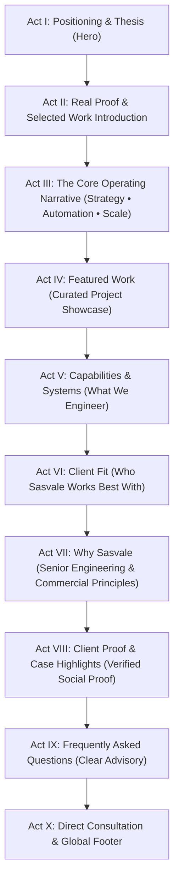

# SASVALE HOMEPAGE NARRATIVE & SECTION CHOREOGRAPHY: ARCHITECTURAL EDITORIAL

**Brand**: Sasvale  
**Tagline**: Strategy. Automation. Scale.  
**Philosophy**: Architectural Editorial — Restrained, Typographic, Authentic, Human  
**Document Purpose**: Define the precise sequence, layout composition, content standards, and visual behavior for each of the 10 homepage acts, replacing AI-agency clichés and unverified imports with verifiable Sasvale work and commercial clarity.

---

## 1. Master Sequence Overview

The revised 10-act structure reflects a logical executive conversation:

---

## 2. Detailed Section Specifications

### Act I: Hero (Positioning & Strategic Thesis)
- **Role**: Establish immediate commercial authority, clarity of purpose, and an unmistakable visual signature without relying on AI-style gimmicks.
- **Layout**: Asymmetric 55/45 desktop split on Deep Obsidian canvas (`#070707`) with crisp 1px hairline boundary rules.
- **Left Column (Typographic Thesis)**:
  - **Eyebrow**: `STRATEGY • AUTOMATION • SCALE` in Champagne Gold (`11px DM Sans`, uppercase, letter-spacing `0.2em`).
  - **H1 Headline** (`Manrope`, 68px–80px desktop, weight 500, letter-spacing `-0.04em`, line-height 1.05):
    > **"Engineering Digital Systems That Compound at Scale."**
  - **Supporting Narrative** (`DM Sans`, 17px, line-height 1.75, color `--color-text-secondary` `#96938A`):
    > *"Sasvale designs and engineers custom web platforms, automated workflows, and digital products for ambitious businesses. Senior engineering leadership, transparent architecture, and measurable longevity."*
  - **Call to Action Pair**:
    - Primary: 8px solid Champagne Gold button (`.btn-gold`): `"Schedule Strategy Call"`
    - Secondary: 8px hairline outline button (`.btn-secondary`): `"View Selected Work ↓"`
- **Right Column (Hero Media — RECOMMENDED OPTION A)**:
  - **Option A (Recommended): Curated Real Project Composition**:
    - An asymmetric, layered editorial arrangement of authentic deliverables from confirmed work (e.g., an architectural browser view of Rassani POS alongside a mobile viewport of Ethletia).
    - Framed with subtle 1px hairline rules (`rgba(255, 255, 255, 0.08)`).
    - Dignified, static, and authentic—looks commanding even with motion disabled.
  - **Option B (Alternative): Restrained Sasvale Monogram Composition**:
    - Subtle architectural watermark of the aerodynamic "S" monogram rendered with thin geometric lines.
  - **Option C (Alternative): Abstract Architectural Geometry**:
    - Clean geometric rules derived from the 45-degree angle and proportion of the Sasvale mark.
  - **Strictly Banned**:
    - ❌ NO rotating 3D spheres or celestial orbs.
    - ❌ NO floating Strategy/Automation/Scale glass chips.
    - ❌ NO cursor-following glow halos.
    - ❌ NO fake dashboard or terminal mockups.

---

### Act II: Real Proof & Selected Work Introduction
- **Role**: Immediate commercial grounding below the fold. Demonstrates delivery capability through real work rather than unverified client logos or invented metrics.
- **Layout**: Architectural editorial band with hairline top and bottom dividers.
- **Content**:
  - **Typographic Lead** (`Manrope`, 24px, weight 500):
    > *"We engineer bespoke web systems, specialized e-commerce platforms, and automated business tools for organizations that demand precision."*
  - **Verified Engagement Focus**:
    - High-Performance Web & Platform Architecture
    - Custom Retail & Point-of-Sale Systems
    - Educational Portals & Digital Learning Platforms
    - Workflow Automation & Data Synchronization
  - **Proof Integrity Note**: Unverified FleekBiz client logos (Magoos, Cottread, Bomeco, Bake Me Happi, Artior, Bloom Beauty) are **completely removed**. This section focuses strictly on verified focus areas and confirmed project categories.

---

### Act III: The Core Operating Narrative (Strategy • Automation • Scale)
- **Role**: Unpack Sasvale's core brand philosophy as a connected operating progression.
- **Core Truth**:
  > **"Strategy defines direction. Automation creates leverage. Scale compounds the result."**
- **Layout & Visual Representation**:
  - A clean, **typographic-led indexed sequence** connected by a subtle structural line (NOT floating orbital chips):
  - **01 / Strategy (Direction & Architecture)**:
    - *Premise*: Without clear positioning, technical specifications, and user journey mapping, rapid development simply builds the wrong software faster.
    - *Focus*: Architectural roadmap, technical stack evaluation, user research, data modeling.
  - **02 / Automation (Leverage & Systems)**:
    - *Premise*: Manual operations restrict growth. We eliminate repetitive friction through custom integrations, headless pipelines, and intelligent routing.
    - *Focus*: API orchestration, workflow automation, custom dashboards, inventory and data synchronization.
  - **03 / Scale (Compounding Results)**:
    - *Premise*: Platforms built on sound architectural foundations handle increased volume, capture organic search authority, and deliver long-term commercial leverage.
    - *Focus*: Next.js Server Components, sub-second response times, resilient cloud deployment, organic search equity.

---

### Act IV: Featured Work (Curated Project Showcase)
- **Role**: The central visual differentiator of the homepage. Showcases authentic work with observable deliverables.
- **Confirmed Portfolio Works**:
  1. **Ethletia**: High-performance athletic apparel e-commerce experience with streamlined product filtering and responsive checkout flow.
  2. **Rassani POS & Technologies**: Bespoke cloud point-of-sale interface and enterprise retail architecture.
  3. **Engineers & Doctors School & Coaching**: Digital educational portal, structured course catalog, and student intake system.
  4. **TBS Salon**: Premium service brand architecture, online appointment booking experience, and local authority presence.
  5. **Wind Deflectors / StampJam / Zenfia / Online Goodies / Roger Edwards**: Specialized e-commerce and web platforms built for reliability and commercial conversion.
- **Layout Treatment**:
  - **Large-Format Editorial Rows** (alternating left/right media placement).
  - **Sticky Project Metadata**:
    - Project Name & Sector
    - Primary Deliverables (Observable scope: Web Application, UI/UX System, Cloud POS, Storefront)
    - Architecture / Platform
    - Contextual link: `"View Case Study →"`
  - **Oversized Media Crops**: Authentic viewport screenshots framed with 1px hairline rules.
  - **Strict Integrity Rule**: Zero invented statistics, zero fabricated conversion percentages, zero speculative revenues. Unknown metrics remain TBD.

---

### Act V: Capabilities & Systems (What We Engineer)
- **Role**: Provide transparent, high-density service communication with zero internal jargon.
- **Layout**: Numbered architectural capabilities index (replacing 3 generic floating cards):
  - **01 / Web & Platform Engineering**:
    - Modern full-stack web applications built on Next.js, React Server Components, and TypeScript.
    - Fast, server-rendered architectures with clean data contracts and zero unnecessary JavaScript.
  - **02 / Workflow & Systems Automation**:
    - Connecting disparate operational tools, internal database routing, and API integrations.
    - Eliminating manual data entry and administrative bottlenecks.
  - **03 / Brand Identity & Digital Experience**:
    - Comprehensive design systems, typography scales, component token architectures, and responsive interfaces.
    - Ensuring your digital presence matches your commercial credibility.
- **Interaction**: Clean expand/collapse rows with hairline active indicators in Champagne Gold.

---

### Act VI: Client Fit (Who Sasvale Works Best With)
- **Role**: Clear qualification framework that helps prospective clients identify themselves.
- **Layout**: Asymmetric 60/40 presentation:
  - **Left**: Three distinct organizational maturity stages:
    - **01 / Early-Stage Builders**: Ambitious founders with clear vision and capital who need senior engineering partners to build their technical foundation right the first time.
    - **02 / Growing Brands**: Established businesses whose revenue has outpaced their legacy digital presence, needing architectural modernization and elevated design.
    - **03 / Scaling Organizations**: Teams requiring dedicated senior engineering capacity to ship high-impact features and integrations without agency bloat.
  - **Right**: Clean architectural preview of Sasvale's structured deliverables (design system tokens, responsive UI viewports, and architecture documentation).

---

### Act VII: Why Sasvale (Senior Engineering & Commercial Principles)
- **Role**: Establish why clients choose Sasvale over generic agencies or offshore software vendors.
- **Layout**: Asymmetric 2-column differentiator grid with thin hairline borders:
  1. **Direct Senior Engineering**: The engineers who design your technical roadmap are the same specialists writing the code. Zero account-manager intermediaries or junior handoffs.
  2. **Architectural Longevity**: We build on resilient, modern, open-source foundations (Next.js, React, Tailwind, TypeScript) that your team can maintain and scale without proprietary lock-in.
  3. **Clear Technical Communication**: We explain what we build, why we choose each architecture, and document every system thoroughly.
  4. **Commercial Relevance**: Every engineering decision is measured against real operational and business outcomes, not aesthetic vanity.

---

### Act VIII: Client Proof & Case Highlights (Social Proof)
- **Role**: Provide credible social proof and customer validation.
- **Integrity Boundary**:
  - Legacy FleekBiz testimonials (James Berkley, D.A. Rowe, Sydney Cummings, Wen Qian) are **strictly removed**.
  - **If Verified Sasvale Testimonials are Available**: Display them in an elegant editorial pull-quote format with verified client name, company, and role.
  - **If Testimonials Remain Unconfirmed**: Present an **Observable Case Study Deep-Dive** highlighting a real delivered platform (e.g. Rassani POS or Ethletia) with observable architecture, system screenshots, and technical milestones.
  - **Zero Fabricated Reviews**.

---

### Act IX: Frequently Asked Questions (Clear Advisory)
- **Role**: Address procurement questions, technical capabilities, and engagement timelines before initial contact.
- **Layout**: Single-column accessible accordion with numbered items (`01` through `05`):
  - **Q1**: *What types of projects does Sasvale take on?* (Custom web platforms, workflow automation, design systems, and digital product engineering).
  - **Q2**: *How is an engagement structured?* (Milestone-based Statements of Work with clear deliverables and acceptance criteria).
  - **Q3**: *Who will actually work on our codebase?* (Senior principal engineers directly handle architecture, implementation, and code reviews).
  - **Q4**: *What technology stacks do you specialize in?* (Next.js, TypeScript, React Server Components, Tailwind CSS, PostgreSQL, headless CMS, and modern cloud APIs).
  - **Q5**: *How do you handle ongoing maintenance after launch?* (Structured support agreements and full code ownership transfer).
- **Accessibility**: Full keyboard navigation, `aria-expanded` attributes, and clean CSS state transitions.

---

### Act X: Direct Consultation & Global Footer
- **Role**: Seamless, low-friction conversion terminal and comprehensive site navigation.
- **Layout**: Two-column architectural conversion block:
  - **Left (The Invitation)**:
    - Headline: *"Start a Technical Conversation."*
    - Narrative: *"Tell us what you are building. We will provide an honest architectural assessment, recommended tech stack, and clear delivery timeline."*
    - Direct Contact: `hello@sasvale.com`
    - Verified Social Channels: X/Twitter (`@sasvaleltd`), LinkedIn (`@sasvaleltd`), Instagram (`@sasvaleltd`), GitHub (`@sasvaleltd`).
  - **Right (Intake Form)**:
    - Pure CSS dark inputs with hairline borders and Champagne Gold focus states.
    - Fields: Full Name, Work Email, Phone / WhatsApp (optional), Project Overview.
    - Action: Solid Gold Button (`.btn-gold`: `"Send Project Brief"`).
  - **Bottom Legal Bar**:
    - Clean copyright: `© 2026 Sasvale. Strategy. Automation. Scale. All rights reserved.`
    - Direct links to Privacy Policy, Refund Policy, and Terms & Conditions.
